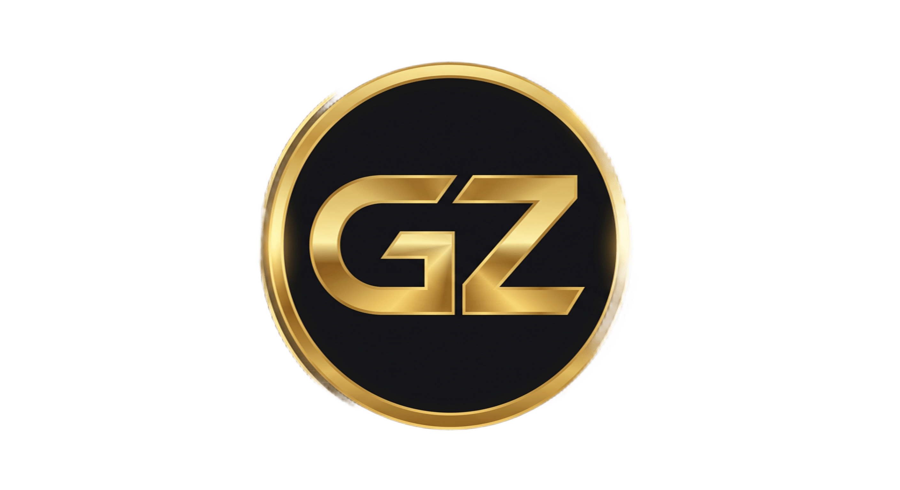

# Abd Alrahaman Mohamed

**Full-Stack Engineer  ·  AI Systems  ·  Applied Security Research**

Alexandria, Egypt  ·  Remote-first

---

**13 OSS organisations with active public standing · 4 PRs merged · 7 security advisories submitted (6 nOAuth-class across identity vendors, 1 Trigger.dev earlier)**

🏆 Formalized **PTB — Provider Trust Boundary** as a measurement framework for OIDC consumer libraries, grounded in a six-vendor sweep over eight days (Supabase, Hanko, Documenso, Auth.js, Keycloak, Casdoor). Four GitHub Security Advisories in triage (two at CVSS 9.8 confirmed in the GHSA record). Public methodology, scanner, fix-pattern library at **[ptb-report-card](https://github.com/61465/ptb-report-card)** + **[identity-trust-hunt](https://github.com/61465/identity-trust-hunt)**.

🏆 Earlier this month: formalized **APDS — Asymmetric Patch Detection for Symmetric APIs** (vulnerability-discovery methodology). First application: un-patched symmetric sibling of CVE-2024-40658, byte-identical across 6 AOSP branches for 25 months. Submitted to Google ASR (**CVSS 10.0 Critical** · in panel review). Reference tool at **[apds-hunt](https://github.com/61465/apds-hunt)**.

**Merged this cycle**
- ✅ **Sentry Relay #6508** — derived trace context prefers DSC `trace_id` · Rust · merged by MEMBER @vjeranc 2026-10-22
- ✅ **SvelteKit #17432** — `adapter-cloudflare` swaps the platform proxy on `wrangler.toml` change · merged by MEMBER @teemingc 2026-10-16
- ✅ **Supabase storage #1500** — TUS `X-Supabase-Object-Id` response header · merged by @ferhatelmas 2026-10-14
- ✅ **PostHog #5083** — opt-in WebView bot detection

**Open PRs across the stack**
- 🔧 **Sentry-JS #25348** — Nuxt pages-router client-plugin unit tests (5 code paths × 13 cases, 3 Bugbot gaps closed on rebase, pre-blessed by MEMBER @JPeer264)
- 🔧 **Drizzle ORM #6497** — `useLiveQuery` on `expo-sqlite` subscribes to joined tables (new `SQLiteRelationalQuery.getReferencedTables()`, cycle-guarded)
- 🔧 **Inngest #5004** — single shared TracerProvider via `BatchSpanProcessor`, stops a per-run `OtelTracerProvider` leak
- 🔧 **Supabase storage #1488** — auto-select URL-signing JWK from `JWT_JWKS`
- 🔧 **Supabase storage #1499** — magic-byte MIME validator, 61 tests + 2 security-review iterations
- 🔧 **Supabase auth #2863** — preserve OAuth 2.1 client sessions during MFA step-up
- 🔧 **PostHog #5244** — rrweb `MutationBuffer.processBufferedMutations` O(n²) → O(n), 500-row shadow-DOM regression

**Design proposals accepted-for-review**
- 📝 **Supabase storage RFC #1521** — Adaptive Content-Aware Reactive Storage (3 composable layers · 4-PR delivery plan)
- 📝 **undici RFC #6043** — interceptor diagnostics_channel events (3 channels · 30-50 LOC)
- 📝 **Prisma ORM #20678** (v7 maintenance line) — ALS-based transparent transaction propagation for `$extends`
- 📝 **Node.js core #55422** (v22.x / v24.x LTS) — LTS-only fix for `Buffer.copy` silent corruption past 4 GiB
- 📝 **Nitro #4471** (v3 line) — conditions-aware `externals.ts` resolve

**Security advisories**

- 📝 **Six-vendor nOAuth / PTB sweep (2026-10-14 → 2026-10-21)**:
  - `GHSA-ffp4-94w6-vfgv` · Supabase · CVSS 9.8 (record) · in triage
  - `GHSA-2gvh-5vh3-m2rp` · Hanko · CVSS 9.8 (record) · in triage
  - `GHSA-hm26-jm32-3wp4` · Documenso · Critical · in triage
  - `GHSA-x3fc-mfpw-93f6` · Auth.js · High · in triage
  - Keycloak · CVSS 9.4 · vendor-email channel, Response Team acknowledged
  - Casdoor · CVSS 9.4 / 8.0 · vendor-email channel, filed
- 📝 **Trigger.dev `GHSA-65rr-73jq-6qhf`** · CVSS 9.6 · in triage
- 📝 **Documenso `GHSA-2rp7-mrh6-v9m2`** · CVSS 7.6 · in triage (first-ever GHSA on the repo, earlier singleton)

---

- **Top 16% (325 / 2,076 teams)** on Kaggle *AI Agent Security: Multi-Step Tool Attacks* — verified score **83.745**
- Reduced WhatsApp ban rate from Meta's 0.5% baseline to **0.1%** (5× improvement) via a 13-layer defense stack in production SaaS
- **90.6% adversarial containment at 5.9% FPR** on 8,000 seeded sessions — [Ariadne](https://ssrn.com/abstract=6870178) framework (SSRN preprint)
- Hospital-ready radiology AI: **69 s per 24-slice CT at 92% confidence** — midcine v3
- Shipped **134-agent NEXUS catalog** with MCP orchestration + a five-verifier grounding gate that removed 724 unsupported cyber claims across 770 production invocations

---

- **[ptb-report-card](https://github.com/61465/ptb-report-card)** — measurement framework for OIDC consumer libraries against the Provider Trust Boundary class (methodology · 4 provider contracts · fix-pattern library · 35-case test suite · CVD-lite disclosure). MIT. Oct 22, 2026.
- **[identity-trust-hunt](https://github.com/61465/identity-trust-hunt)** — static scanner for Provider Trust Boundary call sites. 8-provider dictionary · 24-test regression harness. MIT. Oct 21, 2026.
- **[apds-hunt](https://github.com/61465/apds-hunt)** — reference tool for the APDS methodology (XOR Rule theorem + 6-step algorithm). MIT. Oct 2026.
- **[Ariadne: Adaptive, Human-in-the-Loop Defense for AI Agents](https://ssrn.com/abstract=6870178)**  ·  SSRN 6870178  ·  Jun 2026
- **[Oblivion Gate: Zero-Trace Fragmentation in Distributed Data Architectures](https://papers.ssrn.com/sol3/papers.cfm?abstract_id=6602478)**  ·  SSRN 6602478  ·  May 2026

---

**Languages** · Python · TypeScript · JavaScript · Rust · Go · Dart · SQL · LaTeX
**AI / ML** · PyTorch · Transformers · LoRA · DPO · Ollama · Claude API · MCP · RAG · LangGraph · multi-agent orchestration
**Web / Backend** · Next.js 15 · React · NestJS · FastAPI · Node.js · Express · Prisma · PWA · Turborepo · pnpm workspaces
**Healthcare** · DICOM · pynetdicom · highdicom · OHIF v3 · Cornerstone3D · FHIR R4 · HL7
**Cybersecurity** · OIDC trust-contract analysis · WebAuthn/Passkeys · OAuth2 · SIEM · SOAR · EDR · YARA · pen testing (TCM-certified) · adversarial-AI defense · responsible disclosure (CVSS 3.1)
**DevOps** · Docker · Kubernetes · Firecracker · gVisor · Tailscale mesh · Cloudflare Tunnel · self-hosted PaaS (Ollama + Vaultwarden + Gitea + Grafana)

---

---

- **ptb-report-card** (measurement framework for OIDC consumer libraries against the Provider Trust Boundary class) — [github.com/61465/ptb-report-card](https://github.com/61465/ptb-report-card)
- **identity-trust-hunt** (static scanner for PTB-unsafe call sites, backing the ptb-report-card methodology) — [github.com/61465/identity-trust-hunt](https://github.com/61465/identity-trust-hunt)
- **MEDNEXA** (Egyptian healthcare integration platform — HIS × LIS × PACS, HL7v2 + FHIR R4 + DICOM, PDPC-aligned audit) — [github.com/61465/MEDNEXA](https://github.com/61465/MEDNEXA)
- **Thawani** (WhatsApp Commerce SaaS, live paid tenants) — [thawani.cc](https://thawani.cc) · backup landing on GitHub Pages if the domain is down: [61465.github.io/thawanidemo](https://61465.github.io/thawanidemo/) · source: [github.com/61465/Thawani](https://github.com/61465/Thawani)
- **apds-hunt v0.1** (public reference tool for the APDS vulnerability-discovery methodology) — [github.com/61465/apds-hunt](https://github.com/61465/apds-hunt)
- **Nexus Zone portfolio companion** — [61465.github.io/Nexus_Zone_Portfolio_Companion](https://61465.github.io/Nexus_Zone_Portfolio_Companion/) · source: [github.com/61465/Nexus_Zone_Portfolio_Companion](https://github.com/61465/Nexus_Zone_Portfolio_Companion)

---

*Selected showcases from the ecosystem. Full source code, datasets, and proprietary models remain private for commercial and research reasons.*
